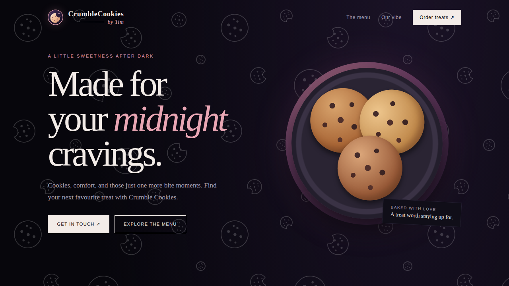
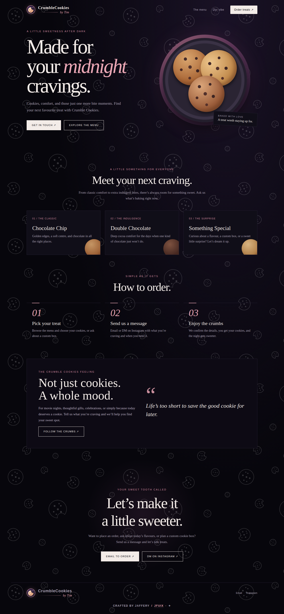
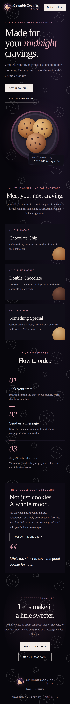

# <div align="center">



# CrumbleCookies by Tim

**Made for your midnight cravings.**

A dark, dreamy website concept for a small batch cookie bakery, with a menu, ordering steps and Instagram and email contact.

[Features](#features) · [Live demo](https://jfuix.github.io/CrumbleCookiesbyTim/) · [Screenshots](#screenshots) · [Run locally](#run-locally) · [Credits](#credits)

</div>

---

## Features

- [x] Dark midnight theme with a soft pink accent
- [x] Custom cookie logo and favicon
- [x] Faint cookie pattern background with whole and half eaten cookies
- [x] Menu cards, "How to order" steps and a quote section
- [x] Email and Instagram order buttons
- [x] Fully responsive on desktop and mobile
- [x] One HTML file, no build step
- [ ] Real flavours, prices and photos (placeholders for now)

## Screenshots



<p align="center">
  
</p>

## Run locally

```bash
git clone https://github.com/JFUIX/CrumbleCookiesbyTim.git
cd CrumbleCookiesbyTim
```

Open `index.html` in your browser.

## Credits

Crafted by Jaffery / [JFUIX](https://github.com/JFUIX). Demo version; menu items and ordering steps are placeholders.
