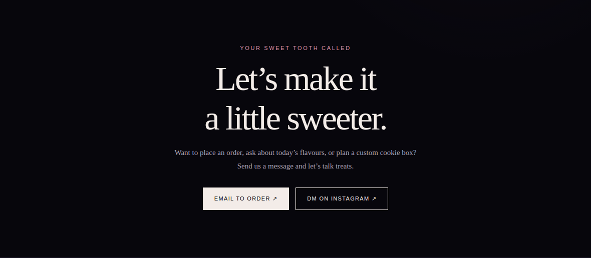

<div align="center">


# CrumbleCookies by Tim

**Made for your midnight cravings.**

A dark, dreamy website concept for a small-batch cookie bakery, featuring a product menu, ordering guidance, and direct contact options.

[Overview](#about-the-project) · [Problem](#problem-it-addresses) · [Features](#key-features) · [Tech stack](#technology-stack) · [Screenshots](#screenshots) · [Live demo](#live-demo)

</div>

---

## About the Project

CrumbleCookies by Tim is a bakery website concept built around a distinctive midnight-inspired visual identity. The design pairs a deep near-black and plum background with soft pink accents, custom cookie artwork, and an atmospheric cookie-pattern texture.

The page introduces the bakery concept, presents menu cards, explains how to order, and gives visitors direct email and Instagram contact options.

## Problem It Addresses

A small food business needs more than an attractive homepage: visitors should be able to understand what is offered and how to place an order. This concept brings the menu, ordering steps, and contact routes into one focused, mobile-friendly experience.

## Key Features

- Dark midnight palette with soft pink accents
- Custom cookie logo and favicon
- Decorative cookie-pattern background artwork
- Menu cards and ordering-step section
- Quote / brand-story section
- Email and Instagram contact actions
- Responsive layouts for desktop and mobile
- Single HTML file with no build step

## Technology Stack

- **HTML5** — page structure and content
- **CSS3** — responsive layouts, custom visual styling, and decorative patterns
- **Inline SVG** — custom favicon and vector artwork
- **Vanilla JavaScript** — lightweight interface behavior, where applicable

## Screenshots

### Desktop


### Mobile

<p align="center">
  
</p>

### Ordering Section



## Live Demo

[Visit CrumbleCookies by Tim](https://jfuix.github.io/CrumbleCookiesbyTim/)

## Run Locally

```bash
git clone https://github.com/JFUIX/CrumbleCookiesbyTim.git
cd CrumbleCookiesbyTim
```

Open `index.html` in a modern browser. No build tools or package installation are required.

## Project Status & Limitations

**Status:** Front-end demo / portfolio concept.

- Menu items, flavors, prices, and product imagery are placeholders and should be replaced with verified bakery information.
- Email and Instagram actions are contact routes, not a full checkout system.
- Cart management, online payment, order tracking, and inventory management are not implemented.
- Real business contact details and ordering policies should be added before production use.

## Credits

Designed and developed by [JFUIX](https://github.com/JFUIX).
